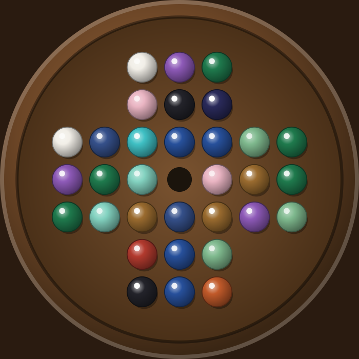

# Pebble Stone

A native Android take on **peg (marble) solitaire** — the English 33-hole cross
board — built with Kotlin and Jetpack Compose. The board and gemstone marbles are
drawn entirely in code with Compose `Canvas` (no image assets), styled after a
polished wooden solitaire set.



## How to play

- The board starts full except for the centre hole.
- Tap a stone to select it. Legal destinations light up with an amber ring.
- Tap a highlighted hole to **jump** the stone over its neighbour; the jumped
  stone is removed.
- Keep going until no jumps remain. Finish with a single stone to win.

Controls: **Undo** steps back one move; **New Game** reshuffles the gemstones and
resets.

## Build & run

This is a standard Android Studio project.

1. Open the `PebbleStone/` folder in **Android Studio** (Koala 2024.1.1 or newer).
2. Let it sync — Android Studio provides Gradle and its bundled **JDK 17** (AGP
   8.5 requires JDK 17; don't build with a newer JDK from the command line).
3. Pick a device/emulator (API 26+) and press **Run**.

> Note: `gradle/wrapper/gradle-wrapper.jar` is not included in this scaffold. On
> first sync Android Studio regenerates it. To build from the command line
> instead, run `gradle wrapper --gradle-version 8.9` once (needs a local Gradle),
> then use `./gradlew assembleDebug`.

## Project layout

```
app/src/main/java/com/example/pebblestone/
├─ MainActivity.kt              # Compose entry point
├─ model/
│  ├─ GameState.kt              # immutable board + peg-solitaire rules
│  ├─ GemPalette.kt             # the gemstone colour set
│  └─ GameStats.kt              # lifetime play statistics
├─ data/
│  └─ StatsRepository.kt        # persists stats via SharedPreferences
└─ ui/
   ├─ GameScreen.kt             # screen: header, status, streak, controls, stats dialog
   ├─ BoardView.kt              # Canvas board/marble rendering + tap hit-testing
   ├─ PebbleController.kt       # UI state: selection, moves, undo, hint, stats
   ├─ ColorUtils.kt             # lighten/darken helpers
   └─ theme/Theme.kt            # colours + Material3 theme
```

## Retention features

- **Daily challenge** — a date-seeded board (same for everyone that day) with a
  separate daily win streak. Every starting vacancy is solvable to one stone, so
  each day is fair. Toggle **Free / Daily** at the top.
- **Stats & streaks** — games played/won, win rate, best result, current/best
  win streak, plus daily streak — persisted across launches, shown in a dialog.
- **Hint** — highlights one legal move with a pulsing ring (the natural hook for
  a future rewarded ad).
- **Animated jumps** — the moving stone slides into place while the jumped stone
  fades and shrinks away.
- **Sound & haptics** — a wooden "tock" + capture pop per move, win/lose cues,
  and a light haptic tick. Mute toggle in the header (persisted). Effects are
  small generated WAVs in `res/raw`, played via `SoundPool`.

Free-play boards randomise the starting vacancy and gem colours each game for
variety; the daily board is fixed per calendar day.

All game rules live in `GameState` (pure, immutable, easily testable); the UI
layer only renders it and forwards taps.

## Tech

- Kotlin 2.0.20, Jetpack Compose (BOM 2024.09.00), Material 3
- `compileSdk` 34, `minSdk` 26, `targetSdk` 34
- Android Gradle Plugin 8.5.2, Gradle 8.9
