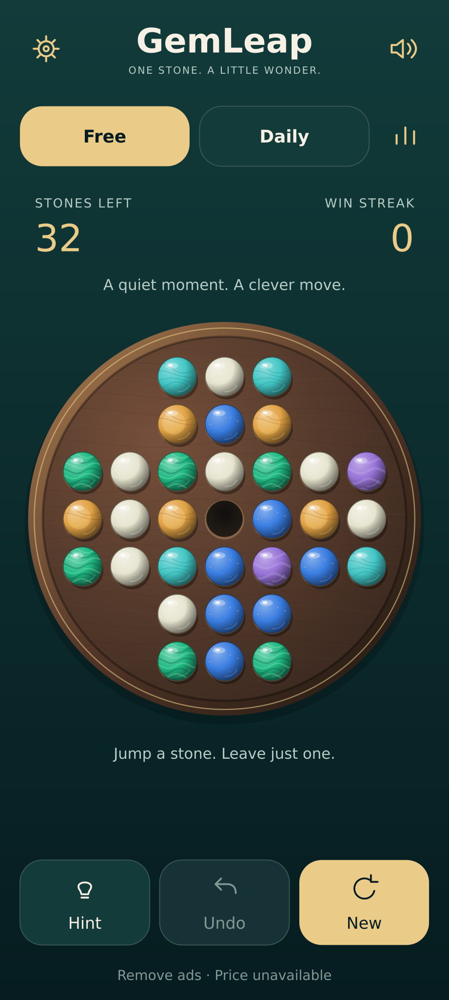

# GemLeap — Jewel Atelier

A native Kotlin/Compose visual upgrade, using original procedural graphics. No paid APIs, assets, subscriptions, or image generation were used.

## Review the result

- PNG export pack: 14 full-bleed 1080 × 2400 **procedural design references**, delivered separately. Regenerate with `python3 tools/render_atelier.py --png`.
- `previews/*.svg`: editable reference sources. These are not captured Android screens and are not pixel-identical to Compose.
- `assets/`: reusable SVG board materials, six gemstone treatments, markers, icons, buttons, theme thumbnails, and launcher artwork.
- `app/src/main/java/com/spore/gemleap/ui/AtelierPreviews.kt`: actual Compose preview definitions for Android Studio, including 320 × 640 dp with 1.5× text and an 800 × 1280 dp tablet. They have not been rendered in this environment.



## Visual direction and tokens

| Role | Value |
|---|---|
| Background | #092B2B; native gradient #123B3A → #061C20 |
| Surface | #123B3A |
| Primary text | #F6F0E5 |
| Secondary text | #B8CEC7 |
| Champagne action/accent | #EACB88 |
| Destination/hint | #8BF0C4 |
| Emerald mineral | #20B984 |
| Lapis mineral | #387CE0 |
| Turquoise mineral | #42C6C5 |
| Amber mineral | #E1A244 |
| Amethyst mineral | #9673D6 |
| Pearl mineral | #E4E2CB |
| Spacing | 8 / 12 / 16 / 18 dp |
| Corners | 16 dp tabs, 18 dp controls, 20 dp results |
| Typography | Platform sans-serif; 27 sp title, 30 sp values, 13–14 sp controls/body |
| Motion | 220 ms jump, three 700 ms hint pulse cycles, 650 ms victory accent |

## Implementation

`MineralArt.kt` owns board grain, recesses, gem materials and highlights. Unit-space grain, vein and fleck geometry is deterministic and cached once. Rendering uses native Canvas; it has no downloaded textures or network dependency. Brushes and per-frame geometry still incur some work; allocation/frame-time profiling has not been performed.

`BoardView.kt` shares geometry between drawing, hit testing and TalkBack semantic cells. The board remains a 33-position English cross. Grid padding is 9.5% and the playable span is 81%, giving more room to the marbles. Targets occupy disjoint square cells. At 360 dp screen width each cell is about 38 dp, smaller than a standard 48 dp standalone control; enlargement and physical-device usability should be checked. A selected piece uses an outline and lift; a destination also has a central dot.

`GameScreen.kt` now has a reusable stateless `GameSurface`, a scrollable constrained layout, relevant daily streak, sound/settings controls, theme thumbnails, consistent dialogs, and a result panel below the board. Re-tapping the already-active mode no longer resets the board. Controls are disabled during the jump. The main game rules, controller, statistics calculations and BillingManager are unchanged.

`GameTheme.kt` adds ATELIER while retaining CLASSIC, LAMPLIGHT and VICTORIAN identifiers. Existing explicit theme preferences remain valid. New installs and invalid preference values use Jewel Atelier. Material colors follow the selected theme. Native theme thumbnails use actual theme palettes; reference thumbnails are illustrative approximations.

`RewardedAdManager.kt` exposes its existing loading/readiness through observable properties; reward handling and free-hint fallback remain unchanged. The dialog communicates ready/loading/unavailable states. The purchase action is disabled until a real billing price is supplied; Restore purchases remains available in statistics. No fabricated purchase price is used in references.

Existing sound and haptic behavior is retained. No new accessibility preference was added. Compose animation APIs follow system duration scaling; this has not been verified on-device.

## Assets and launcher

The Leap icon combines a large emerald marble, smaller sapphire marble, socket and one curved movement cue. Native adaptive vectors are in `res/drawable`; API 33 variants add a monochrome layer. Existing API 26 adaptive resources remain compatible. SVG/PNG icon references use slightly richer procedural marble details than the simplified native vector.

UI glyphs use the existing Material outlined icon dependency. Companion original SVG glyphs are supplied for reference/design use. Live text is separate from artwork. Standalone assets have transparency where appropriate. Button files are shape references; Compose owns actual pressed/ripple, disabled and loading behavior.

## Reproduce reference art

```bash
python3 tools/render_atelier.py          # SVG and manifest; Python standard library
python3 tools/render_atelier.py --png    # additionally requires free local Inkscape
python3 tools/verify_atelier.py
```

The renderer mirrors material formulae and geometry but is a separate implementation. It does not prove native visual parity. Sample statistics are explicitly labeled. The daily date is a fixed October 6, 2026 fixture. Success is produced by replaying `solution.csv`, a verified legal 31-move sequence from the center-vacancy opening. The daily-solved reference depicts the solved-status presentation, not a replay of that day's particular starting board.

## Verification completed

- Exact 33-hole geometry and 3/3/7/7/7/3/3 rows.
- 32-stone center-vacancy opening with four legal initial moves.
- All 31 solution moves legal; each removes exactly one stone; final count one.
- Non-winning terminal fixture has seven stones and no legal moves.
- Every gem fits inside the recessed playing surface; touch cells do not overlap.
- SVG and Android XML parse successfully.
- All screen SVG exports specify 1080 × 2400.
- Body/surface contrast 10.81:1; secondary/surface 7.41:1; action/gold 11.21:1.
- GameState, PebbleController and BillingManager remain unchanged.
- `git diff --check` passes.
- Visual inspection of the generated free-play, settings, success, hint references and launcher icon.

## Build and device limitations — review before merging

`bash gradlew :app:assembleDebug --offline` could not start compilation: Gradle 8.11.1 is not cached and services.gradle.org is unreachable (UnknownHostException). Java 17 is installed; no Android SDK or emulator is available. No APK was produced. Kotlin compilation, Android lint, native screenshots, TalkBack traversal, real billing/ads, large-text layouts and performance remain unverified.

Run in a configured Android environment before merge:

```bash
./gradlew :app:assembleDebug :app:lintDebug
```

Render the supplied Compose previews and test 320 dp / 360 dp phones, landscape and tablets, enlarged text, rapid tapping, undo, mode changes, restart, sound, daily completion, restored theme preferences, all ad availability states, billing-price availability and purchase restoration. Check masked icons at 32 px and 48 px and perform frame-time/allocation profiling. Local screenshot references cannot substitute for these checks.
